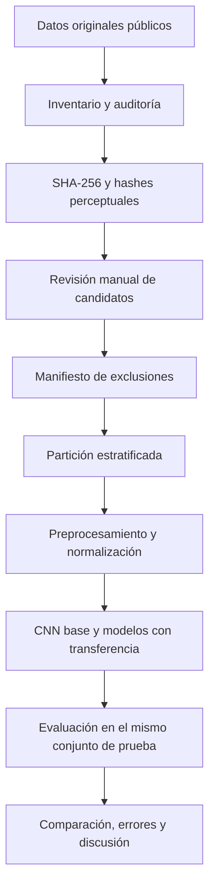

# Clasificación de afecciones fitosanitarias en hojas de rosa mediante aprendizaje profundo

> **Trabajo Fin de Máster · Máster Universitario en Inteligencia Artificial · Universidad Internacional de La Rioja (UNIR)**<br>
> **Modalidad:** comparativa de soluciones · **Estado:** preparación y auditoría de datos completadas; entrenamiento pendiente.

Este repositorio documenta un estudio de **visión artificial aplicada al monitoreo fitosanitario de rosas**. Su objetivo es comparar modelos de aprendizaje profundo en la clasificación de imágenes de hojas de rosa con distintas condiciones visibles, utilizando datos públicos y un protocolo experimental reproducible.

La investigación está concebida como **apoyo al monitoreo**: las predicciones de un modelo no equivalen a un diagnóstico fitopatológico ni sustituyen una evaluación profesional.

## Objetivo de investigación

Comparar el rendimiento de una **CNN de referencia entrenada desde cero** y de arquitecturas **preentrenadas mediante transferencia de aprendizaje** para clasificar afecciones fitosanitarias en hojas de rosa. La comparación se realizará sobre particiones comunes de los datos y se evaluará con métricas globales y por clase, prestando especial atención al **F1 macro** por el desbalance observado.

**Arquitecturas contempladas:** CNN base, MobileNet, ResNet y EfficientNet. Su implementación y sus resultados aún están pendientes; mencionarlas aquí **no significa que ya se hayan entrenado**.

## Estado del proyecto

| Etapa | Estado | Evidencia |
| --- | :---: | --- |
| Revisión bibliográfica y definición del problema | ✅ | Documento del TFM y fuentes científicas |
| Identificación de datasets públicos de rosa | ✅ | RoseNet y RoseLeafInsight |
| Inventario de RoseLeafInsight | ✅ | `resumen_dataset.json`, `inventario_imagenes.csv` |
| Auditoría de integridad y duplicados exactos | ✅ | `resumen_auditoria.json`, `inventario_auditado.csv`, `duplicados_exactos.csv` |
| Búsqueda de posibles imágenes similares | ✅ | `resumen_similitud.json`, `candidatos_similitud.csv` |
| Revisión humana de 78 pares candidatos | ✅ | `planilla_revision_manual_edicion_sugerida.csv` |
| Depuración lógica y plan de particiones estratificadas | ✅ | `resumen_particiones.json`, `particiones_RoseLeafInsight.csv` |
| Extracción y preparación de imágenes para entrenar | ⏳ | Pendiente |
| Entrenamiento y evaluación de modelos | ⏳ | Pendiente |
| Comparativa de resultados y discusión | ⏳ | Pendiente |

> **Alcance de los estados ✅:** describen procesos efectivamente realizados o un **plan de partición generado**. Las fotografías originales **no se han modificado** y **todavía no hay resultados predictivos**.

## Datos utilizados

### RoseLeafInsight (2025) — conjunto principal para el experimento

**3.228 imágenes originales** de hojas de rosa en cuatro categorías. La auditoría local registró:

| Clase | Imágenes | Proporción |
| --- | ---: | ---: |
| Healthy | 1.686 | 52,23 % |
| Yellow Mosaic Virus | 680 | 21,07 % |
| Insect Hole | 453 | 14,03 % |
| Black Spot | 409 | 12,67 % |
| **Total** | **3.228** | **100 %** |

Fuente científica: Shacha et al. (2025), [*RoseLeafInsight: A high-resolution image dataset for rose leaf disease recognition*](https://doi.org/10.1016/j.dib.2025.111968).

**Hallazgos de calidad del conjunto:**

- Se inspeccionaron los **3.228 archivos** sin errores de lectura.
- Se detectaron **2 pares de duplicados binarios** mediante SHA-256 (**4 archivos involucrados**): uno dentro de `Healthy` y otro con **etiquetas contradictorias** entre `Black Spot` y `Yellow Mosaic Virus`.
- Una búsqueda complementaria por **dHash** y **aHash** encontró **78 pares candidatos** a similitud visual, no 78 duplicados. Una revisión manual clasificó **76 parejas como fotografías distintas** y ratificó los dos pares de duplicados exactos.
- Se propuso **excluir tres archivos del conjunto experimental**: ambos archivos del par con etiqueta contradictoria y una copia del duplicado `Healthy`. La propuesta se registra sin borrar ni alterar el dataset original.
- Se observaron imágenes con formato interno JPEG y MPO; la estandarización de entrada a RGB pertenece a la fase pendiente de preprocesamiento.

**Limitaciones:** la verificación perceptual no es exhaustiva; la revisión visual no confirma diagnósticos agronómicos; no se dispone de identificadores de planta/sesión/fecha que permitan garantizar independencia por origen entre las futuras particiones.

### RoseNet (2022) — dataset complementario

Se dispone del archivo original con **917 imágenes**, distribuidas en **404 hojas sanas, 313 con Black Spot y 200 con Downy Mildew**. Su posible incorporación a experimentos independientes está por definirse. **No se fusiona automáticamente con RoseLeafInsight**, porque las clases no son equivalentes.

Fuente científica: Sazzad et al. (2022), [*RoseNet: Rose leave dataset for the development of an automation system to recognize the diseases of rose*](https://doi.org/10.1016/j.dib.2022.108497).

## Diseño experimental previsto



El trabajo sigue una adaptación de **CRISP-DM**: comprensión del problema, comprensión de los datos, preparación, modelado, evaluación y documentación para un posible uso posterior (sin despliegue productivo en esta etapa).

### Particiones propuestas de RoseLeafInsight

Después de las **3 exclusiones propuestas**, el manifiesto contempla **3.225 imágenes candidatas**. Se utilizó la semilla `20261109` y una división estratificada aproximada **70/15/15**:

| Clase | Entrenamiento | Validación | Prueba | Total |
| --- | ---: | ---: | ---: | ---: |
| Black Spot | 286 | 61 | 61 | 408 |
| Healthy | 1.179 | 253 | 253 | 1.685 |
| Insect Hole | 317 | 68 | 68 | 453 |
| Yellow Mosaic Virus | 475 | 102 | 102 | 679 |
| **Total** | **2.257** | **484** | **484** | **3.225** |

**Nota:** esta partición corresponde a **un plan lógico registrado en CSV**; las imágenes aún no se han extraído, redimensionado ni transformado. La separación por archivo, por sí sola, no garantiza independencia por planta o sesión de captura.

En el futuro, las transformaciones de aumento de datos (*data augmentation*) se aplicarán únicamente a **entrenamiento** y **nunca** a validación o prueba.

## Organización del repositorio

La estructura local del proyecto es:

```text
TFM_Rosa_IA/
├── 00_normativa_unir/    # Guías, rúbrica y normas académicas
├── 01_plantilla/         # Plantilla institucional
├── 02_fuentes/           # Literatura y fuentes de contexto
├── 03_datasets/          # ZIP originales (NO subir al repositorio Git)
├── 04_codigo/            # Scripts Python de inventario, auditoría y partición
├── 05_resultados/        # JSON, CSV, figuras y evidencias experimentales
├── 06_documento/         # TFM y anexo de reproducibilidad
└── 07_defensa/           # Material de exposición (pendiente)
```

Para una versión **pública** del repositorio, se recomienda publicar **scripts, README, documentación autorizada y resultados pequeños sin imágenes originales**, dejando fuera los ZIP de varios gigabytes, carpetas de entornos virtuales y archivos privados. Los datasets deberán descargarse desde sus fuentes originales, respetando sus licencias y condiciones de uso.

## Reproducir el trabajo realizado

### Requisitos

- **Windows + PowerShell**, como entorno utilizado hasta el momento.
- **Python 3.9 o superior** y **Pillow** para auditoría y visualización de imágenes. La versión exacta del entorno local debe registrarse en la bitácora antes de reproducir el estudio.
- Copia local del ZIP original de RoseLeafInsight y de los scripts incluidos en `04_codigo`.

Instalación mínima:

```powershell
py -m pip install pillow
```

Los siguientes comandos están pensados para ejecutarse **desde `03_datasets`**. Las rutas de los resultados corresponden a la estructura real del proyecto; esto evita los problemas de ubicación de archivos detectados durante la preparación.

### 1. Inventario inicial y muestra

```powershell
py ..\04_codigo\preparar_muestra_rosas.py "RoseLeafInsight Original Image.zip" --salida "..\05_resultados\reporte_RoseLeafInsight" --por-clase 5
```

Genera el resumen de clases y una muestra reducida. La primera ejecución mostró una clase no identificada porque el nombre de la carpeta `Insect  Hole` tenía dos espacios; la clase se contrastó posteriormente con el inventario y la publicación científica.

### 2. Auditoría de integridad y duplicados exactos

```powershell
py ..\04_codigo\auditar_roseleafinsight.py "RoseLeafInsight Original Image.zip" --salida "..\05_resultados\auditoria_RoseLeafInsight"
```

Lee imágenes, registra dimensiones y detecta archivos idénticos mediante **SHA-256**. **No modifica el ZIP original**.

### 3. Candidatos visualmente similares

```powershell
py ..\04_codigo\revisar_similitud_roseleafinsight.py "RoseLeafInsight Original Image.zip" --inventario "..\05_resultados\auditoria_RoseLeafInsight\inventario_auditado.csv" --salida "..\05_resultados\revision_similitud_RoseLeafInsight" --umbral 4 --umbral-ahash 12 --max-pares 3000
```

Resultado observado: **78 pares candidatos**, con **8 parejas de clases distintas** y **70 de la misma clase**. Las distancias perceptuales son un **filtro de revisión**, no una decisión automática de duplicación.

### 4. Láminas y planilla de revisión manual

```powershell
py ..\04_codigo\preparar_revision_manual_pares.py "RoseLeafInsight Original Image.zip" --candidatos "..\05_resultados\revision_similitud_RoseLeafInsight\candidatos_similitud.csv" --salida "..\05_resultados\revision_manual_RoseLeafInsight"
```

Genera **10 láminas** y una planilla para documentar las 78 decisiones. El análisis visual fue completado manualmente y conserva motivos y acciones sugeridas por pareja.

### 5. Plan lógico de exclusiones y particiones

```powershell
py ..\04_codigo\crear_particiones_roseleafinsight.py --inventario "..\05_resultados\auditoria_RoseLeafInsight\inventario_auditado.csv" --revision "..\05_resultados\revision_manual_RoseLeafInsight\planilla_revision_manual_edicion_sugerida.csv" --salida "..\05_resultados\particiones_RoseLeafInsight"
```

Genera los manifiestos `exclusiones_RoseLeafInsight.csv`, `manifiesto_depuracion.csv`, `particiones_RoseLeafInsight.csv` y `resumen_particiones.json`. **No extrae, elimina ni transforma imágenes.**

> Los comandos son una guía de reproducción conforme a la organización local utilizada. Las ejecuciones originales, las salidas observadas y las incidencias se documentan por separado en la **bitácora técnica** del TFM. Los nombres y rutas deben corresponder a los archivos que efectivamente se publiquen en el repositorio.

## Evaluación prevista

Las arquitecturas se compararán con un mismo protocolo y un **conjunto de prueba reservado**. Se reportarán **accuracy, precision, recall, F1-score por clase, macro-F1 y matrices de confusión**. La interpretación priorizará el rendimiento por clase y los errores, no solo un porcentaje de aciertos global.

**Todavía no existen resultados de entrenamiento**, curvas de aprendizaje ni matrices de confusión. Esta sección se actualizará a medida que se ejecuten los experimentos.

## Evidencias y trazabilidad

La documentación técnica diferencia explícitamente:

1. **Ejecuciones observadas:** comandos realizados, salidas compartidas y archivos derivados.
2. **Decisiones de depuración:** criterios, fotografías implicadas, responsable y fecha de revisión.
3. **Limitaciones y pendientes:** auditorías no exhaustivas, falta de independencia por origen y entrenamiento sin ejecutar.

El documento **«Anexo A. Bitácora técnica de ejecución y trazabilidad»** recoge las incidencias y resultados reproducibles. Para documentación académica, el capítulo 5 contiene el análisis y las tablas esenciales; el anexo y los CSV conservan el detalle.

## Próximas actividades

- [ ] Materializar las particiones desde el ZIP original, respetando el manifiesto validado.
- [ ] Estandarizar lectura RGB, dimensiones y normalización según cada arquitectura.
- [ ] Implementar y entrenar la CNN de referencia.
- [ ] Entrenar arquitecturas preentrenadas bajo condiciones comparables.
- [ ] Calcular métricas en el conjunto de prueba y analizar errores por clase.
- [ ] Incorporar resultados, gráficas, discusión, limitaciones y conclusiones al TFM.

## Referencias principales y atribución

- Shacha, A. D., et al. (2025). *RoseLeafInsight: A high-resolution image dataset for rose leaf disease recognition*. **Data in Brief**. https://doi.org/10.1016/j.dib.2025.111968
- Sazzad, S., et al. (2022). *RoseNet: Rose leave dataset for the development of an automation system to recognize the diseases of rose*. **Data in Brief**. https://doi.org/10.1016/j.dib.2022.108497
- Xu, M., et al. (2024). *Plant disease recognition datasets in the age of deep learning: Challenges and opportunities*. **Frontiers in Plant Science**. https://doi.org/10.3389/fpls.2024.1452551
- Too, E. C., et al. (2019). *A comparative study of fine-tuning deep learning models for plant disease identification*. **Computers and Electronics in Agriculture**. https://doi.org/10.1016/j.compag.2018.03.032

Las imágenes y etiquetas pertenecen a sus fuentes originales. La publicación de los resultados de este proyecto **no transfiere la autoría de los datasets**. Consulta los repositorios y sus condiciones de licencia antes de redistribuir datos.

## Autoría y ámbito académico

**Jhuban Erney Rodriguez Vasquez**<br>
Máster Universitario en Inteligencia Artificial — **UNIR**<br>
**Dirección del TFM:** Adriana Cervantes Castillo.

Este es un **proyecto académico en desarrollo**. Los resultados parciales documentan el procedimiento seguido y no deben interpretarse como validación clínica, agronómica ni como un sistema listo para producción.

> **Licencia del código:** no se declara una licencia de código abierto en este README. Si el repositorio será público y deseas permitir reutilización, añade un archivo `LICENSE` tras elegir la licencia adecuada. Las licencias de los datasets son independientes de la del código.
